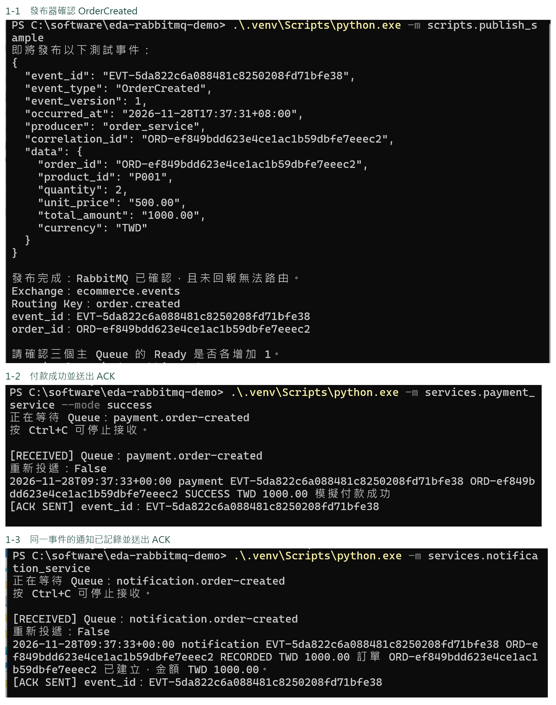
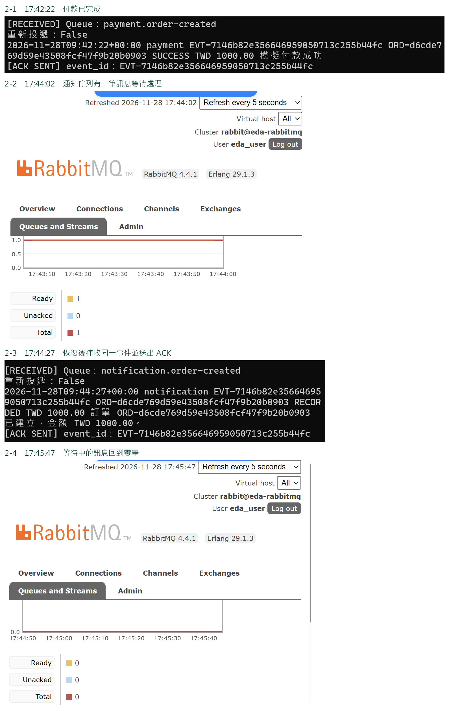
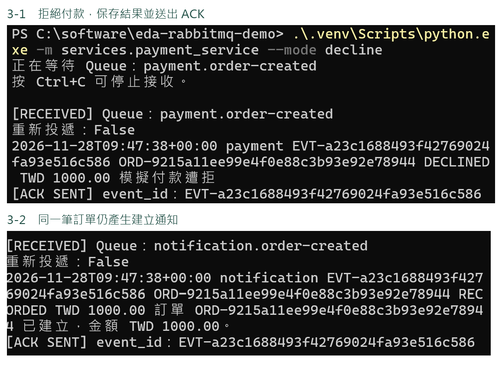
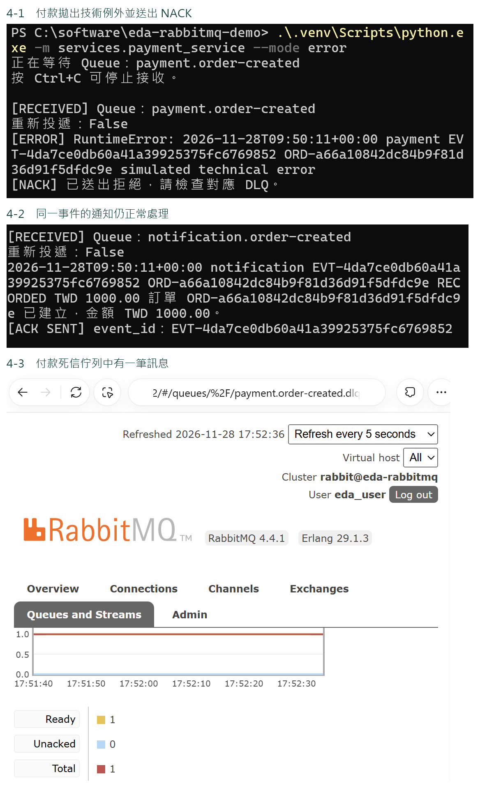
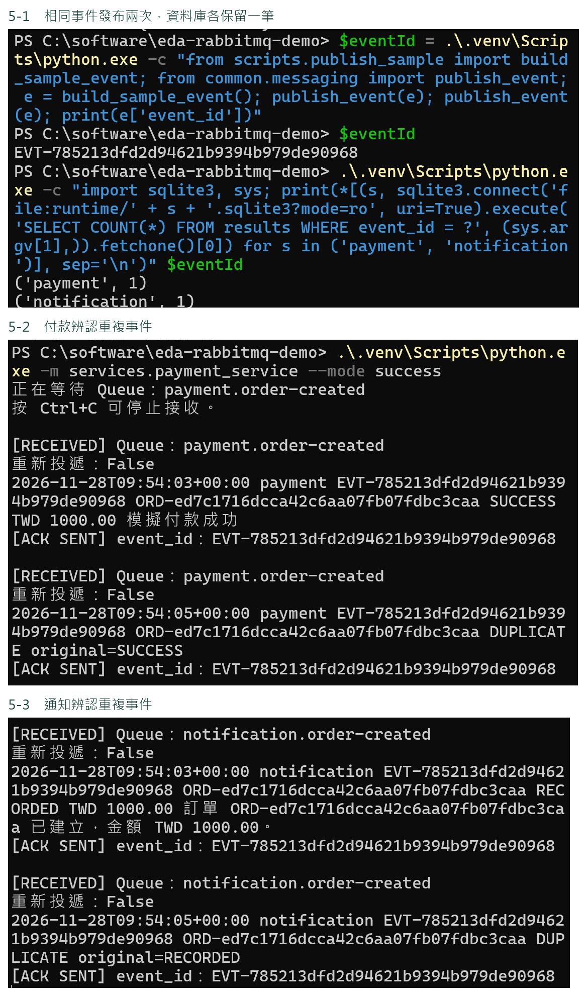
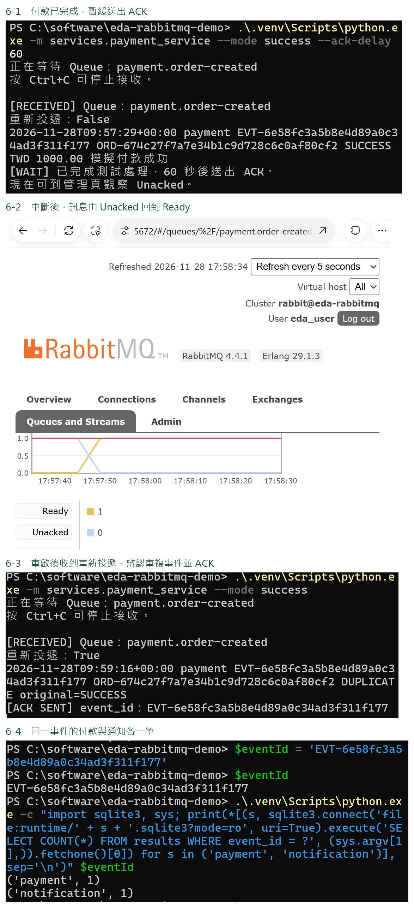

# 付款與通知事件處理測試紀錄

## 一、測試環境

- 測試日期：2026-11-28
- 分支 `feature/payment-notification-d`，工作目錄的基底提交 `3440247`。D 程式於本機分支測試。
- Windows PowerShell、Python 3.13.9、pika 1.5.0、python-dotenv 1.2.4、Docker Engine 29.9.3、RabbitMQ 4.4.1。
- 每筆樣本訂單均為商品 P001、數量 2、單價 TWD 500.00、總金額 TWD 1000.00。發布至 `ecommerce.events`，路由鍵為 `order.created`。
- 付款與通知分別監聽 `payment.order-created` 和 `notification.order-created`。付款技術錯誤的觀察位置為 `payment.order-created.dlq`。
- 以下時間採台灣時間（UTC+8）。SQLite 的 processed_at 與服務終端機採 UTC；對照時已轉換時區。

## 二、RabbitMQ 架構

### Exchange

| Name | Type | Durable |
|---|---|---|
| ecommerce.events | topic | true |
| ecommerce.dlx | direct | true |

### Queue

| 服務 | Queue | Binding Key | DLQ |
|---|---|---|---|
| Payment | payment.order-created | order.created | payment.order-created.dlq |
| Notification | notification.order-created | order.created | notification.order-created.dlq |

### 事件處理與紀錄欄位

付款與通知各自消費一個 Queue。兩個服務均檢查事件類型、版本、事件編號、訂單編號、總額與幣別。完整訂單驗證依小組分工由 C 負責。付款模式由啟動參數決定。通知文字只描述訂單建立。兩者都透過 common.messaging.consume_events 接收事件。

每個服務各有一個 SQLite 檔案，位於 runtime/payment.sqlite3 與 runtime/notification.sqlite3。檔名辨識服務。results 表包含 event_id（主鍵）、order_id、processed_at（含 UTC 時區）、status、total_amount、currency、detail（付款原因或通知文字）。BEGIN IMMEDIATE 將查重及寫入放在同一交易。交易提交後 handler 返回，共用層送 ACK。重送只印 DUPLICATE，保留原紀錄。付款拒絕是已完成的業務判斷，照常保存。技術錯誤由 handler 拋出，共用層印出錯誤並 NACK，requeue=False。測試錯誤沒有已完成的付款資料列。

### 每次事件處理的 JSONL 紀錄

付款與通知分別附加寫入 `runtime/payment.jsonl` 與 `runtime/notification.jsonl`。每一行對應一次 handler 呼叫，欄位為 `service`、`event_id`、`order_id`、`processed_at`（UTC）、`status` 和 `detail`。拒絕原因、技術錯誤或重複事件的原始狀態可從 detail 查得。SQLite 仍保存每筆事件的唯一業務結果。舊測試資料不回填 JSONL。

新增功能已以暫存 SQLite 直接呼叫兩個 handler 驗證：付款依序得到 SUCCESS、DUPLICATE、DECLINED、ERROR（模擬例外）及 ERROR（無效金額）；通知得到 RECORDED、DUPLICATE 及 ERROR（無效金額）。逐行解析 JSON 並核對資料庫筆數通過。下列六張組圖是原本的 RabbitMQ 實測證據。

## 三、功能測試

### Test 01：正常收發

- 發布器確認發布。
- 兩個服務收到同一事件，各自保存後送出 ACK。

- 事件編號：`EVT-5da822c6a088481c8250208fd71bfe38`
- 訂單編號：`ORD-ef849bdd623e4ce1ac1b59dbfe7eeec2`
- SQLite 付款紀錄：17:37:33 SUCCESS。通知紀錄：17:37:33 RECORDED。

結果：通過。



### Test 02：通知暫停與恢復

- 停止通知後發布。
- 付款先完成；17:44:02 通知 Queue 顯示 Ready=1、Unacked=0。
- 重啟後補記同一訂單，17:45:47 Ready=0。

- 事件編號：`EVT-7146b82e356646959050713c255b44fc`
- 訂單編號：`ORD-d6cde769d59e43508fcf47f9b20b0903`
- SQLite 付款紀錄：17:42:22 SUCCESS。通知紀錄：17:44:27 RECORDED。

結果：通過。



### Test 03：模擬付款拒絕

- 付款保存 DECLINED 與原因「模擬付款遭拒」後 ACK。
- 通知獨立保存「訂單已建立」並 ACK。

- 事件編號：`EVT-a23c1688493f42769024fa93e516c586`
- 訂單編號：`ORD-9215a11ee99e4f0e88c3b93e92e78944`
- SQLite 付款紀錄：17:47:38 DECLINED。通知紀錄：17:47:38 RECORDED。

結果：通過。



### Test 04：付款技術錯誤

- 付款印出 RuntimeError 與 simulated technical error，送出 NACK。
- 17:52:36 付款 DLQ 顯示 Ready=1、Unacked=0；SQLite 查無該事件付款結果。
- 通知已保存並 ACK。

- 事件編號：`EVT-4da7ce0db60a41a39925375fc6769852`
- 訂單編號：`ORD-a66a10842dc84b9f81d36d91f5dfdc9e`
- SQLite 付款紀錄：0 筆（技術例外）。通知紀錄：17:50:11 RECORDED。

結果：通過。



### Test 05：同一事件發布兩次

- 兩次發布沿用同一 event_id。
- 兩服務第二次均顯示 DUPLICATE、保留原狀態並 ACK。
- 兩次投遞的 redelivered 皆為 False；逐庫查詢各 1 筆。

- 事件編號：`EVT-785213dfd2d94621b9394b979de90968`
- 訂單編號：`ORD-ed7c1716dcca42c6aa07fb07fdbc3caa`
- SQLite 付款紀錄：17:54:03 SUCCESS。通知紀錄：17:54:03 RECORDED。

結果：通過。



### Test 06：付款提交後、ACK 前中斷

- 付款 SUCCESS 後進入 60 秒 ACK 等待，期間停止服務。
- 付款主 Queue 的 Unacked 從 1 變 0、Ready 從 0 變 1。
- 17:59:16 重啟後讀到 redelivered=True、DUPLICATE original=SUCCESS，接著 ACK。
- 依此事件編號查詢，付款與通知各 1 筆。

- 事件編號：`EVT-6e58fc3a5b8e4d89a0c34ad3f311f177`
- 訂單編號：`ORD-674c27f7a7e34b1c9d728c6c0af80cf2`
- SQLite 付款紀錄：17:57:29 SUCCESS。通知紀錄：17:57:29 RECORDED。

結果：通過。



<details>
<summary>補充：直接呼叫 handler 的測試紀錄</summary>

2026-11-28 使用 Python、暫存 SQLite 與測試事件直接呼叫兩支 handler。查詢結果表核對筆數與狀態。以下結果涵蓋服務內的處理，不含 Broker 傳遞。

|事件／訂單|操作|實際結果|
|---|---|---|
|D-E1／D-O1|成功，TWD 1000.00|付款 SUCCESS 一筆。通知 RECORDED 一筆|
|D-E2／D-O2|拒絕，再重送通知|付款 DECLINED 一筆，原因為模擬付款遭拒。通知仍是「訂單 D-O2 已建立，金額 TWD 1000.00。」第二次顯示 DUPLICATE|
|D-E3／D-O3|付款模擬技術錯誤，獨立執行通知|付款拋出 RuntimeError，付款表沒有該事件。通知保存一筆|
|D-E4／D-O4|四個執行緒同時呼叫付款|付款表只有一筆 SUCCESS，其他三次顯示 DUPLICATE|
|D-E9／D-O9|總額字串為 NaN|兩支 handler 都拋出 ValueError|

</details>

<details>
<summary>本機重現指令</summary>

從專案根目錄操作。先開 Docker Desktop，依 team_handoff 建立 .venv、安裝 requirements.txt，從 .env.example 建立本機 .env 並設定帳密。執行 docker compose up -d，確認 healthy，再用虛擬環境的 Python 執行 scripts.setup_rabbitmq。記下主 Queue 和 DLQ 的原始計數。關閉會競爭同一 Queue 的 sample consumer。

依序開三個 PowerShell 視窗，各行在指定視窗執行。

```powershell
# 視窗一
.\.venv\Scripts\python.exe -m services.payment_service --mode success
# 視窗二
.\.venv\Scripts\python.exe -m services.notification_service
# 視窗三
.\.venv\Scripts\python.exe -m scripts.publish_sample
```

1. 記錄發布器印出的 event_id、order_id。核對兩個服務的金額、文字與 ACK SENT。若 Queue 有其他流量，以事件編號核對。
2. 在付款視窗按 Ctrl+C，將 --mode success 改成 --mode decline 重新啟動。發布新事件。付款應保存 DECLINED 並 ACK；通知仍為訂單建立。
3. 以同樣方法換成 --mode error，發布新事件。應看到該事件技術錯誤及 NACK，付款 DLQ 較基準增加一筆。通知應獨立保存。測完切回 success。
4. 測重送時在視窗三執行下列指令。一份事件發布兩次，付款及通知對該事件應各只有一筆。也可在 Python 互動視窗保留 e，重啟兩個服務後再執行 publish_event(e)，驗證跨重啟去重。

```powershell
.\.venv\Scripts\python.exe -c "from scripts.publish_sample import build_sample_event; from common.messaging import publish_event; e=build_sample_event(); print(e['event_id']); publish_event(e); publish_event(e)"
```

查詢業務結果（服務至少已成功保存過一筆後執行）：

```powershell
.\.venv\Scripts\python.exe -c "import sqlite3; db=sqlite3.connect('file:runtime/payment.sqlite3?mode=ro',uri=True); print(*db.execute('select * from results order by processed_at desc limit 10'),sep='\n')"
.\.venv\Scripts\python.exe -c "import sqlite3; db=sqlite3.connect('file:runtime/notification.sqlite3?mode=ro',uri=True); print(*db.execute('select * from results order by processed_at desc limit 10'),sep='\n')"
```

5. 測試 ACK 前中斷：付款用 --mode success --ack-delay 60，發布新事件，看見 WAIT 後在 60 秒內停止付款程序。在管理頁觀察該 Queue 訊息回到 Ready。正常重啟付款服務，核對相同事件重新投遞、DUPLICATE、ACK SENT 與資料庫僅一筆。此測試使用本機隔離環境。

</details>

## 四、測試結論

六項本機測試均通過。通知暫停期間，付款在 17:42:22 完成，通知在 17:44:27 恢復後保存同一事件並 ACK。付款拒絕與技術例外分別走 ACK 與 NACK／DLQ 流程。發布者重送及 Broker 重新投遞時，兩個服務的 SQLite 各保留一筆結果。

在同步逐一呼叫下游的比較案例中，訂單服務若等待通知服務回應，通知停機可能使流程等待或失敗。Test 02 中，付款與通知各自訂閱獨立 Queue，通知停機期間，付款仍完成；同一事件在付款後 2 分 5 秒由恢復的通知服務處理。此結果仰賴 Broker、正確的綁定以及一致的事件格式。各服務各自提交，第一版沒有跨服務回滾。

## 五、目前尚未涵蓋

- 透過 C 的正式訂單入口，整合 Inventory、Payment 與 Notification。
- 正式整合時，由 E 比對同一筆新訂單的發布、庫存、付款與通知紀錄，完成全組驗收。
